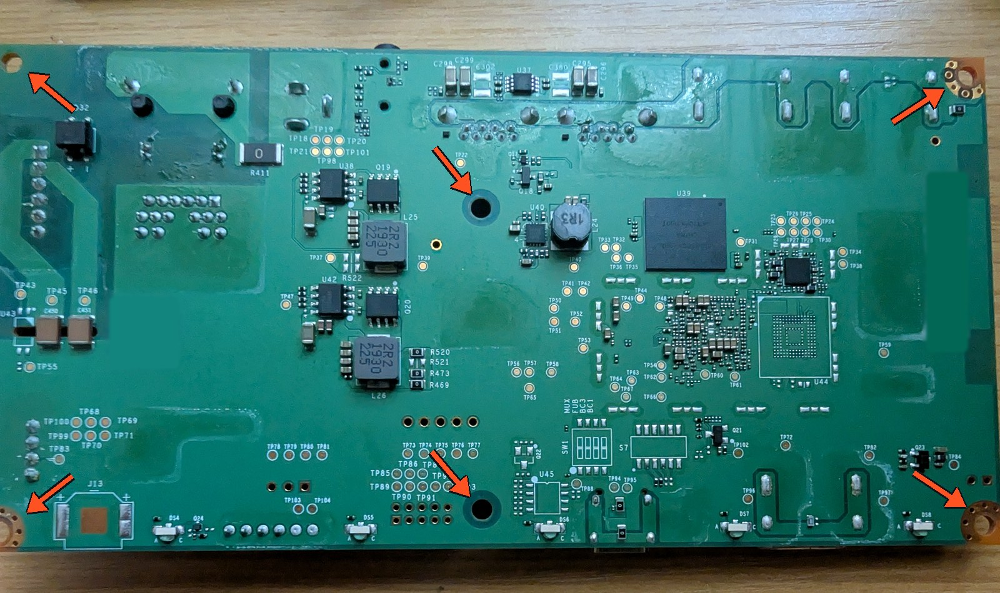
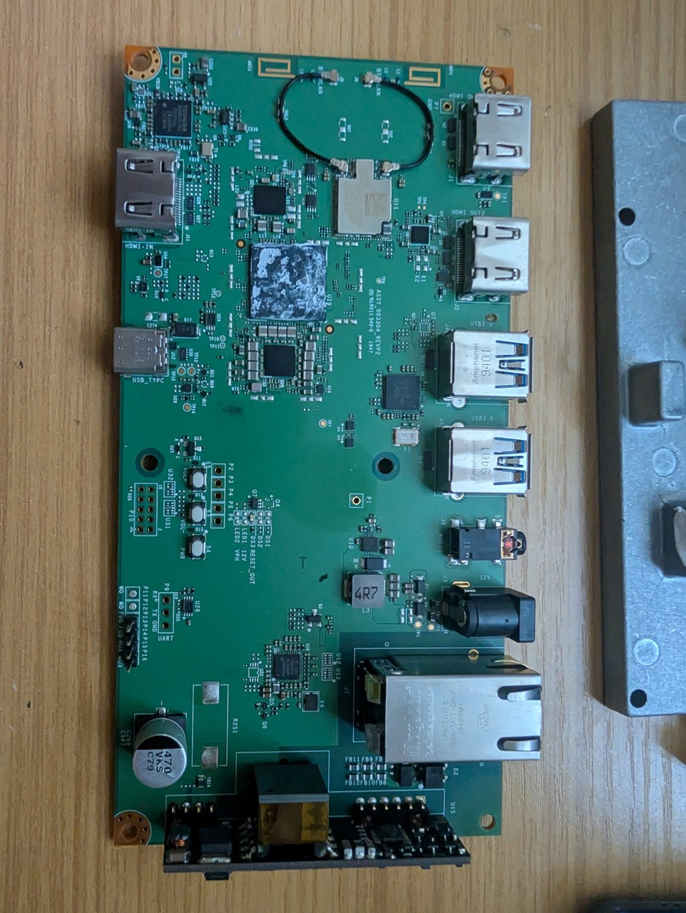
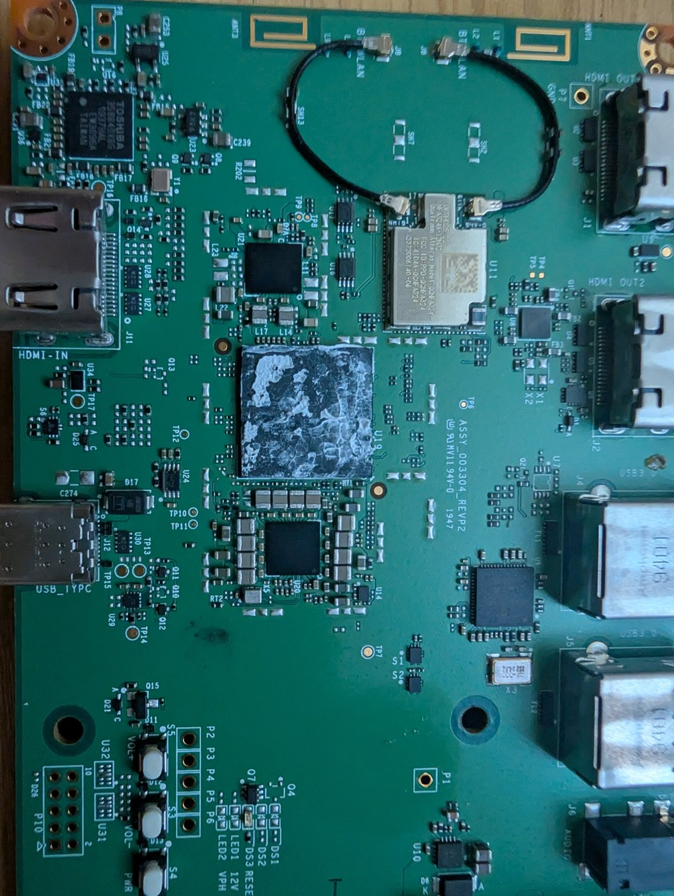
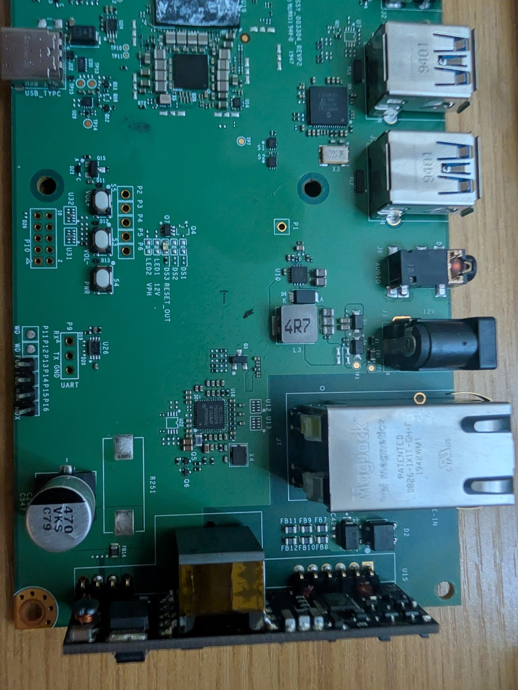
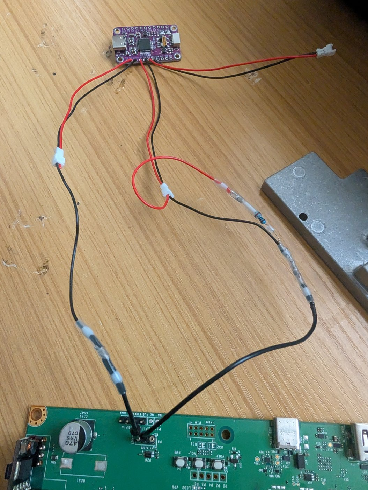

# Solstice Pod TV

### Giving a retired Mersive Solstice Pod Gen3 (`SP8096`) a second life as a 4K Android 15 TV box.

Surplus **Mersive Solstice Pod Gen3 (`SP8096`)** units are everywhere right now — compact matte-black plastic conference-room boxes stuck on **Android 7.1.1** and a 2016 **Linux 3.18** kernel. Inside, though, sits a surprisingly capable **Snapdragon 820 (`APQ8096`)** with 4 GB RAM, 16 GB eMMC, dual HDMI outputs (native 4K@60 Hz + 1080p60), Gigabit Ethernet with PoE+, two USB 3.0 ports, QCA6174A Wi-Fi/Bluetooth, a 3.5 mm jack, and an HDMI-in capture bridge.

**Active hardware bring-up.** Self-booting **Android 15 (LineageOS 22.2)** on a minimal **Linux 4.4.302** kernel is running on physical hardware, with 4K@60 Hz HDMI out, Venus 4K hardware video decode, 5 GHz Wi-Fi (`ath10k_pci`), Bluetooth A2DP, Gigabit Ethernet, and Flirc IR remote verified on a living room TV. The 3.5 mm jack's right channel and `TC358840` HDMI input remain in progress. See [current status](#current-status) before flashing.

<p>
  <a href="https://github.com/NotADevIAmaMeatPopsicle/Solstice-Pod-TV/actions/workflows/ci.yml"></a>
  
  
  
  
  <a href="LICENSE"></a>
</p>

**[Inside the box](#inside-the-box)** · **[The bench rig](#the-bench-rig)** · **[The bring-up story](#the-bring-up-story)** · **[Current status](#current-status)** · **[Flash a Pod in 5 minutes](#flash-a-pod-in-5-minutes)** · **[Build your own](docs/BUILD.md)** · **[Safety rules](docs/SAFETY.md)**

<p align="center">
  <br>
  
</p>
<p align="center"><em>Mersive Solstice Pod Gen3 (SP8096) — front (HDMI-IN, USB-C) and rear (GbE PoE+, 12 V DC, 3.5 mm audio, 2× USB 3.0, HDMI 2, HDMI 1 4K)</em></p>

---

## Inside the box

The first catch when you work on an SP8096: **there are no external reset or fastboot buttons on the enclosure.** If a flashed kernel hangs before `adbd` comes up, you have to open the plastic case to reach the **`S3` (`VOL-`)** tactile button on the PCB (`ASSY_003304_REVP2`).

### Teardown steps
1. **Bottom cover (4 screws):** Peel back the **4 rubber feet on the bottom** of the enclosure to uncover the 4 case screws, then lift off the bottom cover.
2. **Board removal (6 screws):** With the bottom cover off, remove the **6 screws on the underside of the PCB** (4 corner screws + 2 inner mounting screws, marked below) to free the board from the internal metal heatsink and reach `S3` (`VOL-`) and the unpopulated **`P9 UART`** (`RX`/`TX`/`GND`) header on the top side.

| Step 1 — Bottom cover (4 screws under rubber feet) | Step 2 — Board removal (6 screws on PCB underside) |
| :---: | :---: |
|  |  |

| Full board (`ASSY_003304_REVP2`) | APQ8096, QCA6174A Wi-Fi/BT & internal buttons |
| :---: | :---: |
|  |  |

| Rear I/O, Gigabit Ethernet/PoE & `P9 UART` | Bench serial rig (FT232H → `P9 UART`) |
| :---: | :---: |
|  |  |

---

## The bench rig

Early kernel bring-up without serial output is pure guesswork, so a purple **FT232H** breakout wired straight into `P9 UART` did most of the heavy lifting. Combined with the bootloader's `fastboot boot` support (which lets us RAM-boot an AOSP-signed kernel without touching eMMC), we worked under one strict rule the entire time:

> **Never `fastboot flash boot` an untested kernel, and never put an untested `insmod` in `on boot`.**
> RAM-boot first, test new `.ko` modules live from `/data/local/tmp/`, and only automate them under `on property:sys.boot_completed=1`.

---

## The bring-up story

Getting a 2016-era `APQ8096` appliance all the way from stock Android 7.1.1 (Linux 3.18) to **Android 15 (LineageOS 22.2)** on **Linux 4.4.302** came down to five real-world fights:

1. **Staying under the 32 MB (`0x2000000`) bootloader wall.**
   The APQ8096 Little Kernel (`aboot`) silently refuses to boot if the uncompressed kernel + DTB crosses `0x2000000`. Starting from Qualcomm's minimal `msm_defconfig` — dropping LG phone drivers, UFS, battery/charger, NFC, touchscreens, and `cnss` — kept us safely under the ceiling, enforced automatically by `kernel/scripts/check-image-layout.py`.
2. **Pairing the right LineageOS 22.2 donors.**
   We used official LineageOS 22.2 for the **LG G5 (`h850`)** as the `MSM8996` Android 15 system/GPU/Venus base, stripped its phone-only HALs, and transplanted the official LineageOS 22.2 **Xiaomi Mi 5 (`gemini`)** QTI Wi-Fi and Bluetooth HALs so the Pod's `QCA6174A / Rome` radio had native Android 15 HALs.
3. **Finding TLMM GPIO 127 for native 4K HDMI 1.**
   HDMI 2 (`ADV7533`) came up right away at `1080p60`, while HDMI 1 (`9a0000.qcom,hdmi_tx`) looked dead. Diffing the stock DTB revealed **GPIO 127** — driving it HIGH on boot and enabling Display 2 after boot locked straight onto **4K@60 Hz (`594 MHz` pixel clock)** on a living room TV.
4. **Ditching `qcacld-3.0` and catching a 1-line crash in `ath10k`.**
   Stock `qcacld-3.0` kept SSR-crashing on Linux 4.4.302. Switching to upstream `ath10k_pci` enumerated the card cleanly — then immediately panicked on `insmod` with a NULL pointer dereference at `0x0000001c` inside `ath10k_ce_send_nolock`.
   Turning on live `dmesg -w` led straight to `ce.c:491`: a Qualcomm CAF `WCN3990` backport had replaced `src_ring->sw_index` with `vaddr_rri_on_ddr[ce_id]` without checking `if (ar->rri_on_ddr)`. On QCA6174A PCI, `vaddr_rri_on_ddr` is `NULL`, and BMI uses Copy Engine 7 (`7 * 4 = 0x1c`). Fixing that line (`0017`), closing an edge-triggered MSI unmask race + disabling `pci_ps`/ASPM (`0018`), loading `WLAN.RM.4.4.1` (`firmware-5.bin`), and adding an 8-line `wlan.ko` shim for `/sys/module/wlan/parameters/fwpath` brought **5 GHz Wi-Fi** up at **866 Mbps Rx, 0% packet loss** alongside Bluetooth A2DP.
5. **Couch control with Flirc USB.**
   Without an Android TV `tv.cec` HAL yet, plugging a **Flirc USB Gen2** into the rear USB 3.0 port with an old **Rosewill Media Center IR remote** worked out of the box as a native HID keyboard/remote.

---

## Current status

| Subsystem | Hardware / Driver | Status | Notes |
| --- | --- | --- | --- |
| **Boot & OS** | `APQ8096`, 4 GB RAM, 16 GB eMMC | Working | Cold self-boot into Android 15 (LineageOS 22.2) on Linux 4.4.302 |
| **GPU & 4K Decode** | Adreno 530 + Qualcomm Venus | Working | Smooth 4K hardware decode |
| **HDMI 1 (4K Out)** | Native `9a0000.qcom,hdmi_tx` (GPIO 127) | Working | Verified `4096x2160@60` & `3840x2160@60` (`594 MHz` pixel clock) |
| **HDMI 2 (1080p Out)** | DSI0 → `ADV7533` bridge + `SEC_MI2S_RX` audio | Working | `1920x1080@60` with clean HDMI audio |
| **Wi-Fi (2.4 / 5 GHz)** | QCA6174A hw3.2 (upstream `ath10k_pci`) | Working | 5 GHz 802.11ac, auto-loaded after `sys.boot_completed=1` |
| **Bluetooth** | `QCNFA324` (`bluetooth-power.ko` + QTI HAL) | Working | Verified A2DP audio + simultaneous Wi-Fi coexistence |
| **Ethernet & USB 3.0** | Atheros `atl1c` + `6a00000.dwc3` | Working | 1000 Mbps Full Duplex; KB/mouse & Flirc USB Gen2 verified |
| **3.5 mm Audio Jack** | WCD9335 (`J6 AUDIO`, `SLIMBUS_6_RX`) | Partial | Left channel works; right-channel mixer patch staged, needs headphone re-test |
| **HDMI Input** | Toshiba `TC358840` (HDMI → CSI-2) | In progress | DTB grafted; needs kernel headroom trim + V4L2 driver ([notes](docs/AUDIO-AND-HDMI-IN.md)) |
| **HDMI-CEC** | `qcom,hdmi_tx` CEC | Not started | Needs `android.hardware.tv.cec` HAL; Flirc USB works today |

---

## Flash a Pod in 5 minutes

Once you've built the three static images (`pod44-los22-boot-signed.img`, `pod44-los22-recovery-signed.img`, `pod-los22-system.simg`) using [docs/BUILD.md](docs/BUILD.md), converting any additional stock SP8096 takes **~5–8 minutes** with zero compiling:

```powershell
powershell -ExecutionPolicy Bypass -File .\installer\flash-new-pod.ps1 `
  -PodName pod-02 `
  -ImagesDir .\out\images `
  -PlatformToolsDir .\platform-tools
```

The installer never touches `persist`, `modem`, or `bt_firmware`, preserving each Pod's factory MAC addresses and calibration. See [installer/README.md](installer/README.md) and [docs/SAFETY.md](docs/SAFETY.md) before flashing.

---

## Documentation & licensing

- **[docs/ARCHITECTURE.md](docs/ARCHITECTURE.md)** — Donor strategy, DTB, `ath10k_pci`, and HAL details
- **[docs/BUILD.md](docs/BUILD.md)** — Reproducible Ubuntu 24.04 / WSL2 build guide
- **[docs/SAFETY.md](docs/SAFETY.md)** — `0x2000000` ceiling, RAM-boot rule, and recovery notes
- **[docs/AUDIO-AND-HDMI-IN.md](docs/AUDIO-AND-HDMI-IN.md)** — 3.5 mm right-channel & `TC358840` HDMI-in roadmap
- **[NOTICE.md](NOTICE.md)** — Licensing, attribution, and what isn't stored in this repo

---

<sub>Front and rear hardware reference images are from Mersive Technologies documentation; the underside enclosure photo is adapted from public FCC filing <code>2ADCSSP8096</code>. All PCB and bench photos are original. This is an independent project unaffiliated with Mersive Technologies.</sub>
