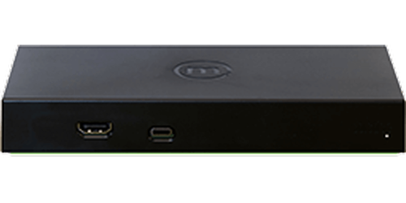
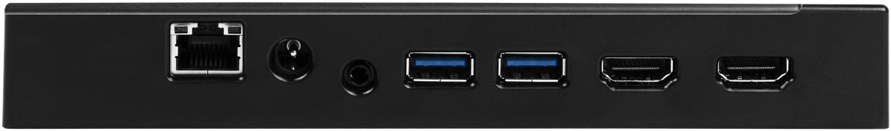
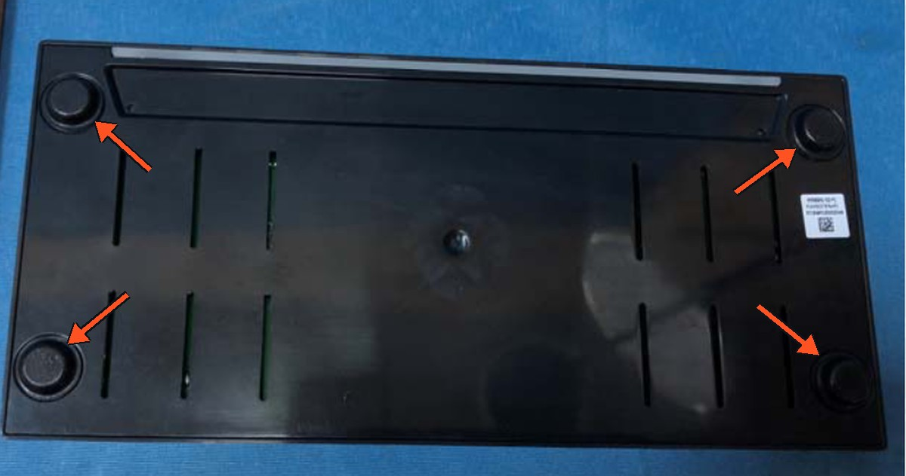
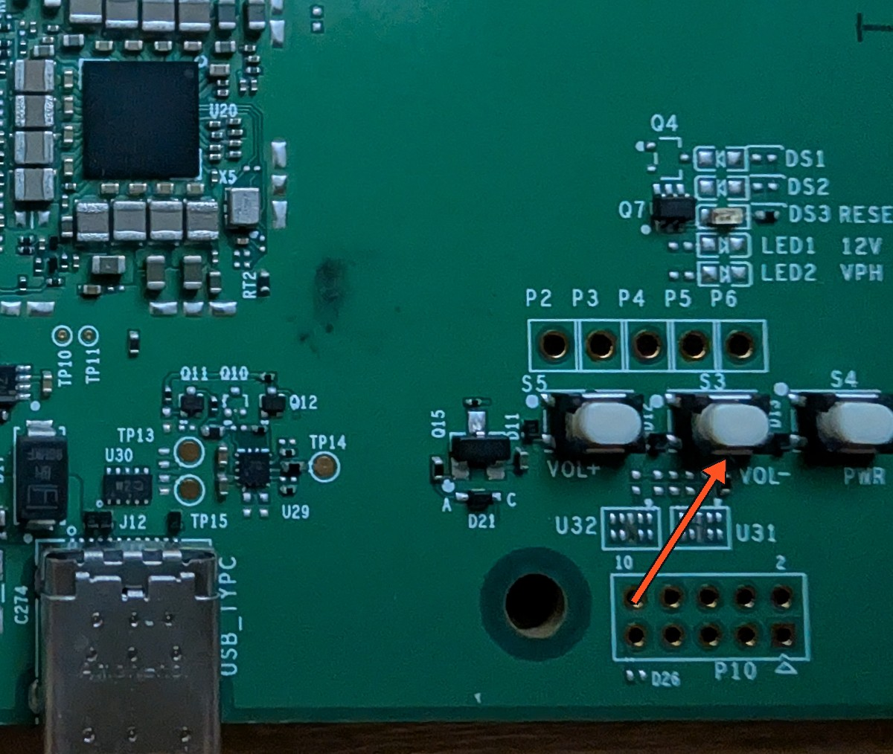

# Solstice Pod TV

### Giving a retired Mersive Solstice Pod Gen3 (`SP8096`) a second life as a 4K Android 15 TV box.

Surplus **Mersive Solstice Pod Gen3 (`SP8096`)** units are everywhere right now. They are compact matte-black plastic conference-room boxes stuck on **Android 7.1.1** and a 2016 **Linux 3.18** kernel. Inside, though, sits a surprisingly capable **Snapdragon 820 (`APQ8096`)** with 4 GB RAM, 16 GB eMMC, dual HDMI outputs (native 4K@60 Hz + 1080p60), Gigabit Ethernet with PoE+, two USB 3.0 ports, QCA6174A Wi-Fi/Bluetooth, a 3.5 mm jack, and an HDMI-in capture bridge.

**Active hardware bring-up.** Self-booting **Android 15 (LineageOS 22.2)** on a minimal **Linux 4.4.302** kernel (with `msm_watchdog_v2` enabled) is running on physical hardware, with 4K@60 Hz HDMI out (auto-reconnecting on hot-plug / TV input switch), Venus 4K hardware video decode, 5 GHz Wi-Fi (`ath10k_pci`), Bluetooth A2DP, Gigabit Ethernet, 3.5 mm stereo audio (`J6 AUDIO`), native **HDMI-CEC TV remote control**, and Flirc IR remote verified on a living room TV. `TC358840` HDMI input remains in progress. See [current status](#current-status) before flashing.

<p>
  <a href="https://github.com/NotADevIAmaMeatPopsicle/Solstice-Pod-TV/actions/workflows/ci.yml"></a>
  
  
  
  
  <a href="LICENSE"></a>
</p>

**[Inside the box](#inside-the-box)** · **[The bring-up story](#the-bring-up-story)** · **[Software & UI](docs/SOFTWARE.md)** · **[Current status](#current-status)** · **[Teardown & flashing walkthrough](#teardown--flashing-walkthrough)** · **[Build your own](docs/BUILD.md)** · **[Safety rules](docs/SAFETY.md)**

<p align="center">
  <br>
  
</p>
<p align="center"><em>Mersive Solstice Pod Gen3 (SP8096): front (HDMI-IN, USB-C) and rear (GbE PoE+, 12 V DC, 3.5 mm audio, 2× USB 3.0, HDMI 2, HDMI 1 4K)</em></p>

### Hardware specs at a glance

| Spec | Mersive Solstice Pod Gen3 (`SP8096`) |
| --- | --- |
| **Processor** | Qualcomm Snapdragon 820 (`APQ8096`), quad-core Kryo (`arm64-v8a`) |
| **GPU & Video** | Adreno 530 + Qualcomm Venus 4K hardware video decode |
| **Memory** | 4 GB LPDDR4 RAM |
| **Storage** | 16 GB internal eMMC (~9.4 GB used with Android 15 + starter TV apps) |
| **Video Out** | Dual HDMI: `HDMI 1` native 4K@60 Hz (`594 MHz` pixel clock) + `HDMI 2` 1080p60 (`ADV7533`) |
| **Video In** | Front `HDMI-IN` via Toshiba `TC358840` HDMI-to-CSI-2 bridge (work in progress) |
| **Networking** | Gigabit Ethernet with PoE+ (`atl1c`) + Dual-band 802.11ac Wi-Fi & Bluetooth (`QCA6174A / QCNFA324`) |
| **USB & Audio** | 2× rear USB 3.0, 1× front USB-C (fastboot/ADB), 3.5 mm stereo audio (`WCD9335`) |
| **OS & Kernel** | Android 15 (LineageOS 22.2) on Linux `4.4.302-podmin+` (upgraded from stock Android 7.1.1 / Linux 3.18) |

---

## Inside the box

The first surprise when you start working on a Mersive Solstice Pod Gen3 (`SP8096`): **there are no external reset or fastboot buttons anywhere on the case.** To reach the internal **`VOL-` (`S3`)** button for fastboot, or the unpopulated **`P9 UART`** (`RX`/`TX`/`GND`) serial header, you have to open the plastic shell and lift the board (`ASSY_003304_REVP2`) out. Once it's open, though, it's a really clean board to work on. Jump down to the [teardown & flashing walkthrough](#teardown--flashing-walkthrough) for the exact screws and button steps.

| Full board (`ASSY_003304_REVP2`) | APQ8096, QCA6174A Wi-Fi/BT & internal buttons |
| :---: | :---: |
|  |  |

| Rear I/O, Gigabit Ethernet/PoE & `P9 UART` | Bench serial rig (FT232H → `P9 UART`) |
| :---: | :---: |
|  |  |

---

## The bench rig

Early kernel bring-up without serial output is pure guesswork, so a purple **FT232H** breakout wired straight into `P9 UART` did most of the heavy lifting. Combined with the bootloader's `fastboot boot` support (which lets us RAM-boot an AOSP-signed kernel without touching eMMC), we worked under one strict rule the entire time:

> **Never `fastboot flash boot` an untested kernel, and never put an untested `insmod` in `on boot`.**
> RAM-boot first, test new `.ko` modules live from `/data/local/tmp/`, and only automate them under `on property:sys.boot_completed=1`.

---

## The bring-up story

Getting a 2016-era `APQ8096` appliance all the way from stock Android 7.1.1 (Linux 3.18) to **Android 15 (LineageOS 22.2)** on **Linux 4.4.302** came down to five real-world fights:

1. **Staying under the 32 MB (`0x2000000`) bootloader wall.**
   The APQ8096 Little Kernel (`aboot`) silently refuses to boot if the uncompressed kernel + DTB crosses `0x2000000`. Starting from Qualcomm's minimal `msm_defconfig` (dropping LG phone drivers, UFS, battery/charger, NFC, touchscreens, and `cnss`) kept us safely under the ceiling, enforced automatically by `kernel/scripts/check-image-layout.py`.
2. **Pairing the right LineageOS 22.2 donors.**
   We used official LineageOS 22.2 for the **LG G5 (`h850`)** as the `MSM8996` Android 15 system/GPU/Venus base, stripped its phone-only HALs, and transplanted the official LineageOS 22.2 **Xiaomi Mi 5 (`gemini`)** QTI Wi-Fi and Bluetooth HALs so the Pod's `QCA6174A / Rome` radio had native Android 15 HALs.
3. **Finding TLMM GPIO 127 for native 4K HDMI 1.**
   HDMI 2 (`ADV7533`) came up right away at `1080p60`, while HDMI 1 (`9a0000.qcom,hdmi_tx`) looked dead. Diffing the stock DTB revealed **GPIO 127**. Driving it HIGH on boot and enabling Display 2 after boot locked straight onto **4K@60 Hz (`594 MHz` pixel clock)** on a living room TV.
4. **Ditching `qcacld-3.0` and catching a 1-line crash in `ath10k`.**
   Stock `qcacld-3.0` kept SSR-crashing on Linux 4.4.302. Switching to upstream `ath10k_pci` enumerated the card cleanly, then immediately panicked on `insmod` with a NULL pointer dereference at `0x0000001c` inside `ath10k_ce_send_nolock`.
   Turning on live `dmesg -w` led straight to `ce.c:491`: a Qualcomm CAF `WCN3990` backport had replaced `src_ring->sw_index` with `vaddr_rri_on_ddr[ce_id]` without checking `if (ar->rri_on_ddr)`. On QCA6174A PCI, `vaddr_rri_on_ddr` is `NULL`, and BMI uses Copy Engine 7 (`7 * 4 = 0x1c`). Fixing that line (`0017`), closing an edge-triggered MSI unmask race + disabling `pci_ps`/ASPM (`0018`), loading `WLAN.RM.4.4.1` (`firmware-5.bin`), and adding an 8-line `wlan.ko` shim for `/sys/module/wlan/parameters/fwpath` brought **5 GHz Wi-Fi** up at **866 Mbps Rx, 0% packet loss** alongside Bluetooth A2DP.
5. **Couch control with native HDMI-CEC (and Flirc USB).**
   We started out using a **Flirc USB Gen2** with an old **Rosewill Media Center IR remote** on the rear USB 3.0 port, which worked out of the box as native HID navigation. Then we dug into `mdss_hdmi_tx.c` and found a single `#define BLOCK_CEC` line that LG had left in their phone kernel. Deleting that one line (`0021`) brought Qualcomm's native `fb1/cec` controller right online on `HDMI 1`. Our lightweight `pod-cec-daemon` (`system/cec/pod-cec-daemon.c`) claims logical address `8` (so it doesn't collide with game consoles on `LA 4` or steal TV inputs) and turns a regular TV remote into native Android navigation over `/dev/uinput`.

---

## Current status

| Subsystem | Hardware / Driver | Status | Notes |
| --- | --- | --- | --- |
| **Boot & OS** | `APQ8096`, 4 GB RAM, 16 GB eMMC | Working | Cold self-boot into Android 15 (LineageOS 22.2) on Linux 4.4.302 |
| **GPU & 4K Decode** | Adreno 530 + Qualcomm Venus | Working | Smooth 4K hardware decode |
| **HDMI 1 (4K Out)** | Native `9a0000.qcom,hdmi_tx` (GPIO 127) | Working | Verified `4096x2160@60` & `3840x2160@60` (`594 MHz`), auto-enables on hot-plug / input switch |
| **HDMI 2 (1080p Out)** | DSI0 → `ADV7533` bridge + `SEC_MI2S_RX` audio | Working | `1920x1080@60` with clean HDMI audio |
| **Wi-Fi (2.4 / 5 GHz)** | QCA6174A hw3.2 (upstream `ath10k_pci`) | Working | 5 GHz 802.11ac, auto-loaded after `sys.boot_completed=1` |
| **Bluetooth** | `QCNFA324` (`bluetooth-power.ko` + QTI HAL) | Working | Verified A2DP audio + simultaneous Wi-Fi coexistence |
| **Ethernet & USB 3.0** | Atheros `atl1c` + `6a00000.dwc3` | Working | 1000 Mbps Full Duplex; KB/mouse & Flirc USB Gen2 verified |
| **3.5 mm Audio Jack** | WCD9335 (`J6 AUDIO`, `SLIMBUS_6_RX`) | Working | Verified left + right stereo output (`RX2`/`RX3` mixer path) |
| **HDMI Input** | Toshiba `TC358840` (HDMI → CSI-2) | In progress | DTB grafted; needs kernel headroom trim + V4L2 driver ([notes](docs/AUDIO-AND-HDMI-IN.md)) |
| **HDMI-CEC** | `qcom,hdmi_tx` CEC (`0021`) + `pod-cec-daemon` | Working | Native TV remote navigation over HDMI 1 (`fb1/cec` -> `/dev/uinput`) |

---

## Teardown & flashing walkthrough

Once you have built the three images (`pod44-los22-boot-signed.img`, `pod44-los22-recovery-signed.img`, `pod-los22-system.simg`) from [docs/BUILD.md](docs/BUILD.md) and have Android Platform Tools (`adb` and `fastboot`, plus the Google `Android Bootloader Interface` USB driver on Windows), getting a stock Mersive Solstice Pod Gen3 (`SP8096`) onto Android 15 takes about **5–10 minutes**:

| Step 1: Bottom cover (4 screws under the rubber feet) | Step 2: Board screws (6 screws holding the board in) |
| :---: | :---: |
|  |  |

1. **Take off the bottom cover (4 screws):** Unplug power and any cables, flip the Pod over, and peel back the **4 rubber feet** in the corners. Take out the 4 screws underneath and lift the bottom cover off.
2. **Pull the board out and set the aluminum block aside (6 screws):** Once the bottom cover is off, you'll see **6 screws** holding the board in place (4 in the corners and 2 in the middle, marked above). Take those out and the board is free to lift right out. That aluminum heatsink block isn't bolted to the board. It's only held on with a light layer of thermal paste, and mine fell right off while I was pulling the board out. Just set the aluminum block aside so you can see and reach the buttons on the top of the board.
3. **Hold `VOL-` (`S3`) while powering on to enter Fastboot:**
   - Plug a **USB-C data cable** into the Pod's **front USB-C port** and connect it to your PC (the rear USB 3.0 ports won't work for fastboot or ADB).
   - Find the **`VOL-` (`S3`)** button on the top side of the board, just to the right of the USB-C port (between `VOL+` and `PWR`, marked below).

   <p align="center">
     
   </p>

   - **Press and hold `VOL-` (`S3`)**, plug in **12 V power** (or PoE+), keep holding it for **about 3–5 seconds**, and then let go.
   - Check that your PC sees the Pod in fastboot mode:
     ```powershell
     fastboot devices
     ```
     You should see a device ID followed by `fastboot`. *(If nothing shows up on Windows, check Device Manager for an unknown Android device and assign it the Google `Android Bootloader Interface` driver.)*
4. **Back up stock partitions and flash Android 15:**
   If you haven't backed up this Pod yet, save copies of `boot`, `recovery`, `persist`, `modem`, and `bluetooth` first. Then run the installer script:
   ```powershell
   powershell -ExecutionPolicy Bypass -File .\installer\flash-new-pod.ps1 `
     -PodName pod-02 `
     -ImagesDir .\out\images `
     -PlatformToolsDir .\platform-tools
   ```
   The script flashes `boot`, `recovery`, and `system`, formats `userdata` and `cache`, reboots into Android 15, skips the phone setup wizard and sleep timer, and prints out a quick check of the kernel, Wi-Fi (`wlan0`), and Bluetooth. It **never touches `persist`, `modem`, or `bt_firmware`**, so your Pod keeps its factory MAC addresses and calibration.
5. **Put it back together and hook it up to your TV:**
   Unplug power and USB-C, set the aluminum heatsink block back onto the board (making sure the thermal paste lines up cleanly), and put the **6 board screws** back in. Snap the bottom cover back on with the **4 case screws** and press the **4 rubber feet** back in place. Plug **`HDMI 1` (the rightmost rear HDMI port)** into your 4K TV, plug a USB keyboard/mouse or **Flirc USB** receiver into one of the rear USB 3.0 ports, and power it up.

Read [installer/README.md](installer/README.md) and [docs/SAFETY.md](docs/SAFETY.md) before flashing.

---

## Documentation, credits & licensing

- **[docs/SOFTWARE.md](docs/SOFTWARE.md)**: What the Android 15 / TV UI software is, what is done so far, and UI work in progress
- **[docs/ARCHITECTURE.md](docs/ARCHITECTURE.md)**: Donor strategy, DTB, `ath10k_pci`, and HAL details
- **[docs/BUILD.md](docs/BUILD.md)**: Reproducible Ubuntu 24.04 / WSL2 build guide
- **[docs/SAFETY.md](docs/SAFETY.md)**: `0x2000000` ceiling, RAM-boot rule, and recovery notes
- **[docs/AUDIO-AND-HDMI-IN.md](docs/AUDIO-AND-HDMI-IN.md)**: Verified 3.5 mm stereo audio notes & `TC358840` HDMI-in roadmap
- **[NOTICE.md](NOTICE.md)**: Licensing, attribution, and what isn't stored in this repo

Big thanks to [erikb-lab/solstice-pod-gen3-androidtv](https://github.com/erikb-lab/solstice-pod-gen3-androidtv) for the initial Solstice Pod Gen3 Android TV lead and bring-up work that helped get this project started.

---

<sub>Front and rear hardware reference images are from Mersive Technologies documentation; the underside enclosure photo is adapted from public FCC filing <code>2ADCSSP8096</code>. All PCB and bench photos are original. This is an independent project unaffiliated with Mersive Technologies.</sub>
