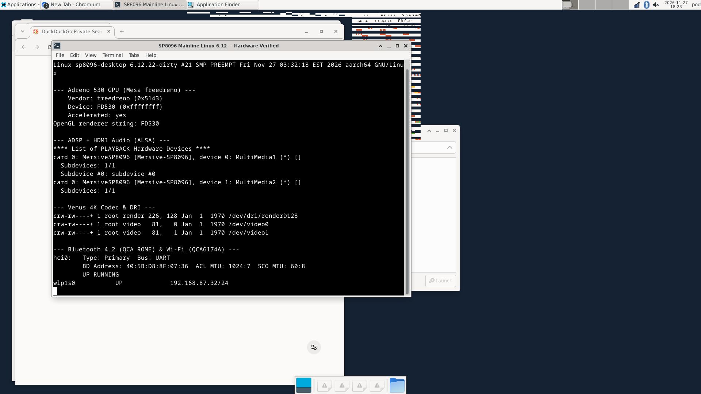

# Mainline Linux 6.12 LTS (Debian 12 Desktop & Server)

Alongside Android 15 TV, the **Mersive Solstice Pod Gen3 (`SP8096` / `APQ8096`)** now boots **Mainline Linux `6.12.22` LTS** with persistent **Debian 12 (Bookworm) ARM64** root filesystems in two flavors—a full **XFCE4 Desktop** and a headless **Docker Server**—both selectable in **[Pod Patcher](https://github.com/NotADevIAmaMeatPopsicle/Pod-Patcher)** without touching factory partitions (`persist`, `modem`, or `bt_firmware`).

## Live Screen Capture (Hardware Verified on Pod `7c0e2d10`)

  

<em>Debian 12 (Bookworm) ARM64 XFCE4 running live on Mainline Linux 6.12.22 LTS over Middle HDMI 2 (1920x1080) with hardware-accelerated Adreno 530 (Mesa <code>freedreno FD530</code>), ADSP HDMI audio, Venus 4K codec, Bluetooth 4.2, QCA6174A Wi-Fi, and Chromium.</em>

---

## Verified Hardware Status (`6.12.22` LTS)

| Subsystem | Hardware / Mainline Driver | Live Status | Notes |
| --- | --- | --- | --- |
| **Boot & Storage** | `APQ8096` LK (`fastboot boot` / eMMC `boot` + `system`) | **Working** | Self-syncing `switch_root` initramfs (`LABEL=SP8096_ROOT` USB 3.0 first → eMMC → rescue shell); ARM64 image enforced `< 0x2000000` (`4.45 MB` headroom) |
| **CPU & RAM** | 4× Kryo (`arm64`) / 3.6 GiB RAM | **Working** | Locked to `729.6 MHz` (`performance` governor, `43–46 °C`) until upstream `qcom,cpr3-msm8996-hmss-regulator` lands |
| **3D GPU** | Adreno 530 (`&gpu` + `&adreno_smmu` + Mesa `freedreno`) | **Working** | `OpenGL renderer: FD530 (Accelerated: yes)`, `/dev/dri/renderD128`, Xorg `modesetting` + `glamor` + Chromium; capped to `133–214 MHz` OPP |
| **Edge HDMI 1** | Native `9a0000.hdmi-tx` + `mdp_smmu` + TLMM GPIO 127 | **Working** | `1920x1080@60` (`148.500 MHz` exact pixel clock) |
| **Middle HDMI 2** | `994000.dsi` → `ADV7533` @ `0x39`/`0x3c` (`blsp2_i2c2`) | **Working** | `1920x1080` live on living-room TV (HPD polling mode + `vcca-supply`); dual-HDMI auto-layout via `/usr/local/bin/sp8096-display-setup.sh` |
| **HDMI Audio** | ADSP `remoteproc0` (`adsp.mbn`) + `MersiveSP8096` ALSA | **Working** | Verified audible stereo L/R 48 kHz audio on Middle HDMI 2 TV via `SECONDARY_MI2S_RX` (`gpio80/81/82`) + `0005-asoc-qcom-apq8096-mi2s-bclk.patch` + `/etc/asound.conf` (`dmix`) |
| **4K Video Codec** | Qualcomm Venus (`&venus` + `&venus_smmu` + `venus-4.2/venus.mbn`) | **Working** | `/dev/video0` (decoder) and `/dev/video1` (encoder) live with zero SMMU faults |
| **Wi-Fi** | QCA6174A hw3.2 (`ath10k_pci`, `wlp1s0`) | **Working** | `WLAN.RM.4.4.1-00309`, OTP calibration, hardware crypto |
| **Bluetooth 4.2** | QCA ROME (`hci_uart`, `hci0`, `firmware-atheros`) | **Working** | `bluez` + `blueman`, actively discovering nearby BT/BLE devices |
| **Ethernet & USB** | Atheros Gigabit (`atl1c`, `enP2p1s0`) + Rear USB 3.0 + Front USB-C `g_serial` | **Working** | SuperSpeed USB 3.0 rootfs/HID + plug-and-play `COM` serial console (`ttyGS0`) |
| **Software Reboot** | `qcom,pshold` (`restart@4ab000`, `msm-restart`) | **Working** | Clean `sudo reboot` and `sudo reboot bootloader` without manual power-cycling |

---

## The Mainline Bring-Up Fights

Getting stock Android 7.1.1 TrustZone firmware on a 2016 `APQ8096` appliance to play nicely with **Mainline Linux 6.12** came down to five real-world fixes (all kept as minimal, clean patches):

1. **Keeping TrustZone happy across all four SMMUs (`0004-iommu-arm-smmu-qcom-skip-init.patch`).**
   Stock mainline `arm-smmu` resets all SMR/S2CR registers and writes `0xffffffff` to `SMR0` during probe, which immediately trips SP8096's TrustZone XPU and hard-resets the board. Porting `qcom,skip-init` and `qcom,no-smr-check` (the exact flags used in stock Linux 4.4 `pod25.dtb`) let `mdp_smmu` (`0xd00000`), `adreno_smmu` (`0xb40000`), `venus_smmu` (`0xd40000`), and `lpass_q6_smmu` (`0x1600000`) all attach cleanly with zero faults.
2. **VRAM framebuffer ops (`0001-drm-msm-fbdev-iomem-ops.patch`).**
   A 1-word switch (`FB_GEN_DEFAULT_DEFERRED_SYSMEM_OPS` → `FB_GEN_DEFAULT_DEFERRED_IOMEM_OPS`) fixed `fb0: Framebuffer is not in virtual address space.` on the MDP5 VRAM carveout.
3. **Middle HDMI 2 (`DSI0 → ADV7533`) live TV bring-up.**
   Probing `blsp2_i2c2` (`0x75b6000`) revealed `ADV7533` at `0x39` / `0x3c`. Adding `vcca-supply = <&vreg_l28a_0p925>` on `&mdss_dsi0` and running `adv7533` in HPD polling mode (instead of edge-triggered GPIO 95 IRQ) stopped a live-TV boot hang and brought up 1080p video immediately.
4. **Getting audible stereo HDMI 2 audio out of ADSP + `ADV7533` (`0005-asoc-qcom-apq8096-mi2s-bclk.patch`).**
   Stripping DragonBoard 820c's WCD9335 SLIMbus links and `MCLK -> RX_BIAS` route registered `card 0: MersiveSP8096`. Wiring `SECONDARY_MI2S_RX` (`gpio80/81/82`) → `&adv7533`, patching `sound/soc/qcom/apq8096.c` to set `SND_SOC_DAIFMT_BP_FP | SND_SOC_DAIFMT_I2S` + `Q6AFE_LPASS_CLK_ID_SEC_MI2S_IBIT` (`1.536 MHz`), and adding `/etc/asound.conf` (`dmix` with `period_size 4096` / `buffer_size 16384`) unlocked clean stereo 48 kHz TV audio.
5. **CPU & GPU voltage ceilings without upstream CPR3.**
   Confirming against stock `pod25.dts` and live `i2cdetect` showed the external I2C buck regulators (`hl7509` / `ncp6335d`) are unpopulated on SP8096—voltage scaling is handled by `qcom,cpr3-msm8996-hmss-regulator` (`cpr3-ctrl@99e8000`), which isn't in mainline 6.12 yet. Locking Kryo CPUs to `729.6 MHz` (`sp8096-cpufreq-cap.service`) and capping `&gpu_opp_table` to `214 MHz` keeps everything rock-solid at `43–46 °C`.

---

## Two Flavors (Shared Kernel & Auto-Syncing Initramfs)

Both flavors share `pod-linux612-boot-signed.img` (which automatically syncs `/lib/modules/6.12.22-dirty/` onto your rootfs whenever the kernel modules change) and can be tested safely via **RAM-boot** (leaving Android 15 TV on eMMC untouched) or flashed persistently to eMMC (`boot` + `system` only) via **[Pod Patcher](https://github.com/NotADevIAmaMeatPopsicle/Pod-Patcher)**:

- **Linux Desktop (`Debian 12 XFCE4`):** Full desktop with LightDM auto-login (`pod` / `pod`), Mesa `freedreno` (`FD530`), Chromium, NetworkManager, Bluetooth (`blueman`), ALSA `dmix` HDMI audio, SSH, and `ttyGS0` serial console.
- **Linux Server (`Debian 12 + Docker`):** Headless Debian 12 ARM64 (`sp8096-server`) with SSH, NetworkManager, QCA6174A Wi-Fi + Bluetooth, Venus 4K, and `docker.io` + `docker-compose` pre-installed.
- **Linux Apps & Docker Stack Picker in Pod Patcher:** Select **Linux Desktop** or **Linux Server** in Pod Patcher and open the **Linux Apps & Docker** tab to push curated APT apps (`Chromium`, `VLC`, `Kodi`, `RetroArch`, `Tailscale`, `Cockpit`, `Syncthing`) and 1-click Docker Compose stacks (`Portainer CE`, `Uptime Kuma`, `Home Assistant`, `Jellyfin` with `/dev/dri` + Venus 4K passthrough, `Homepage`, `FileBrowser`, `Watchtower`) directly to `~/stacks/` over SSH.
