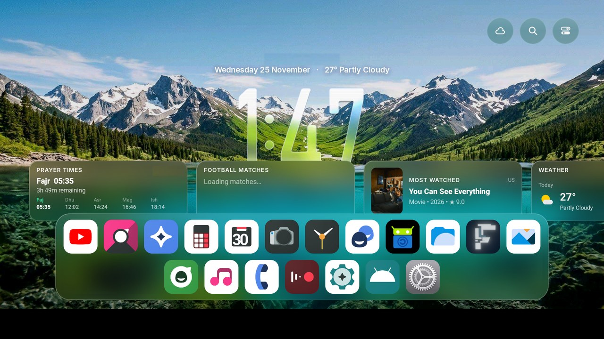
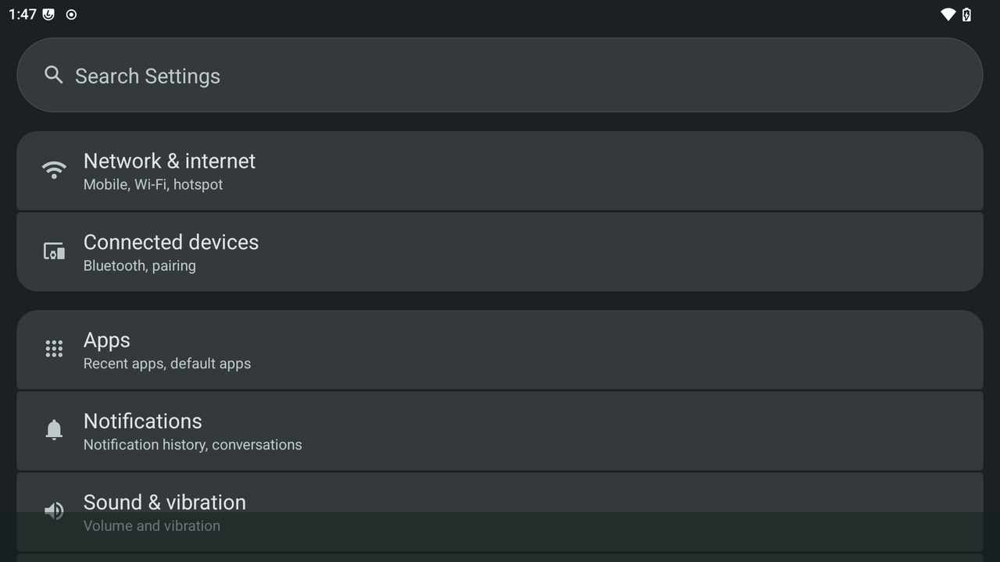

# Software & TV UI (Work in Progress)

> **Heads up:** The software side is still a work in progress, and **the UI has not been prettied up yet.** Right now the goal has been getting the underlying hardware rock-solid (cold self-boot, 4K@60 Hz HDMI, hardware video decode, 5 GHz Wi-Fi, Bluetooth, Ethernet, and IR remote input) before spending time polishing the front-end look and feel.

## What the UI looks like right now

| Current TV launcher (work in progress) | Android 15 (LineageOS 22.2) Settings |
| :---: | :---: |
|  |  |

You can see it is still rough around the edges (default widgets and a handful of leftover stock Android app icons still sitting in the dock), which is next on the list now that the core hardware is behaving.

## What is running on the Pod right now

Under the hood, the Mersive Solstice Pod Gen3 (`SP8096`) is running **Android 15 (LineageOS 22.2)** on top of a minimal **Linux 4.4.302** kernel (`4.4.302-podmin`).

- **System base:** Official LineageOS 22.2 for the **LG G5 (`h850`)**, which shares the Qualcomm `MSM8996 / APQ8096` platform (Adreno 530 GPU + Venus 4K hardware video decoder). Phone-only HALs (telephony, fingerprint, sensors, NFC, camera) are stripped out.
- **Wireless HALs:** Official LineageOS 22.2 QTI Wi-Fi and Bluetooth HALs pulled from the **Xiaomi Mi 5 (`gemini`)** so the Pod's `QCA6174A / Rome` radio speaks native Android 15.
- **TV launcher & apps:** Because LineageOS `h850` starts out as a phone build, we skip the phone setup wizard, turn off the lockscreen and sleep timeout, and set a TV-friendly launcher as the default home screen. So far we have tested `tvOS-Launcher` (`com.techgenius.tvoslauncher`) as the default home activity, along with `FLauncher`, `SmartTube`, and `F-Droid` as optional side-loaded apps (downloaded directly from their upstream releases; no APKs are bundled in this repo).

## What we have done on the software side so far

1. **Cold self-boot into Android 15:** Everything lives on internal eMMC (`boot`, `recovery`, `system`), so unplugging power and plugging it back in boots straight into Android 15 without needing a PC attached.
2. **Automatic Wi-Fi and Bluetooth after boot (`init.pod.wifi.rc`):** Instead of risking early-boot kernel panics in `on boot`, `system/init/init.pod.wifi.rc` waits for `sys.boot_completed=1`, loads `bluetooth-power.ko` and the upstream `ath10k_pci` Wi-Fi stack (`cfg80211`, `mac80211`, `ath`, `ath10k_core`, `ath10k_pci`, plus our tiny `wlan.ko` shim), and brings 5 GHz Wi-Fi and Bluetooth A2DP up automatically.
3. **4K@60 Hz living-room output:** Driving `TLMM GPIO 127` HIGH on boot wakes up native `HDMI 1` (`9a0000.qcom,hdmi_tx`) at `3840x2160@60` and `4096x2160@60` (`594 MHz` pixel clock), with Adreno 530 rendering and Venus 4K hardware decode working smoothly.
4. **Couch navigation without HDMI-CEC (yet):** Plugging a **Flirc USB Gen2** into either rear USB 3.0 port with an old **Rosewill Media Center IR remote** works out of the box as native HID keyboard/D-pad navigation.
5. **TV box defaults in the installer (`installer/flash-new-pod.ps1`):** On first boot, the installer marks the device provisioned, disables the phone Setup Wizard, disables the lockscreen, sets `screen_off_timeout` to max so the box never goes to sleep mid-movie, and optionally installs any TV APKs you drop into `out/tv-apks/`.

## What is still a work in progress

- **Polishing the TV UI:** Right now it is a functional bring-up UI, not a finished living-room experience. Cleaning up the launcher layout, 4K TV DPI/overscan defaults, Leanback/TV app icons, and overall look and feel is still ahead.
- **3.5 mm stereo audio:** The left channel works on `J6 AUDIO` (`WCD9335` / `SLIMBUS_6_RX`); a right-channel mixer fix is staged and waiting on a headphone re-test.
- **HDMI-CEC remote support:** Needs an `android.hardware.tv.cec` HAL so a standard TV remote can drive the UI directly over HDMI without needing a Flirc USB dongle.
- **HDMI Input (`TC358840`):** The Toshiba HDMI-to-CSI-2 bridge has its device-tree nodes drafted, and the next step is trimming kernel size headroom and bringing up the V4L2 capture driver (see [docs/AUDIO-AND-HDMI-IN.md](AUDIO-AND-HDMI-IN.md)).
- **Production watchdog:** Re-enabling `msm_watchdog_v2` once the remaining drivers are finalized.
