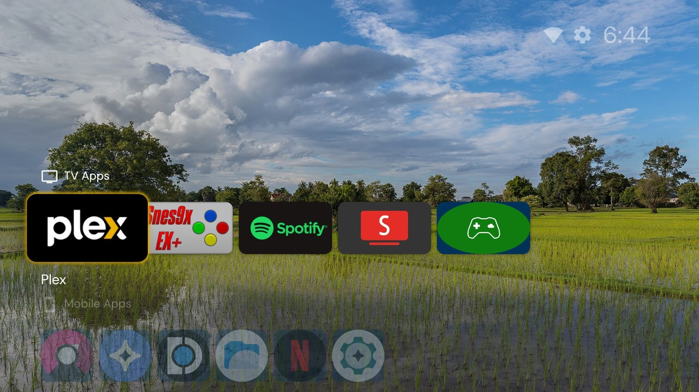
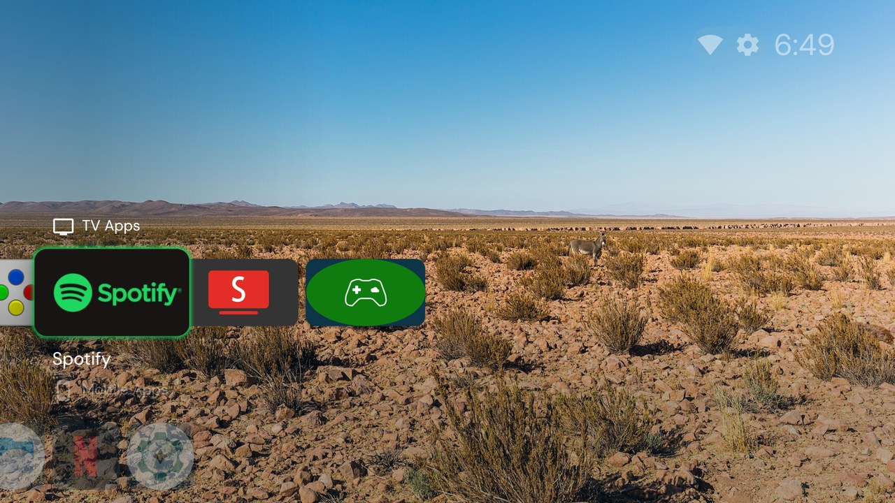
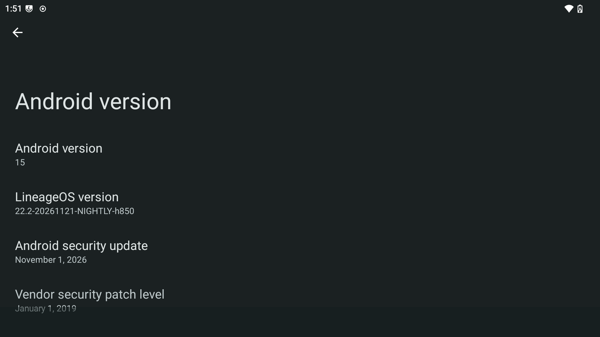
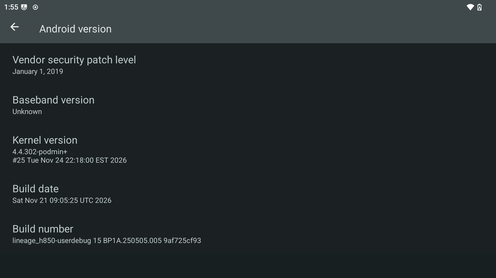
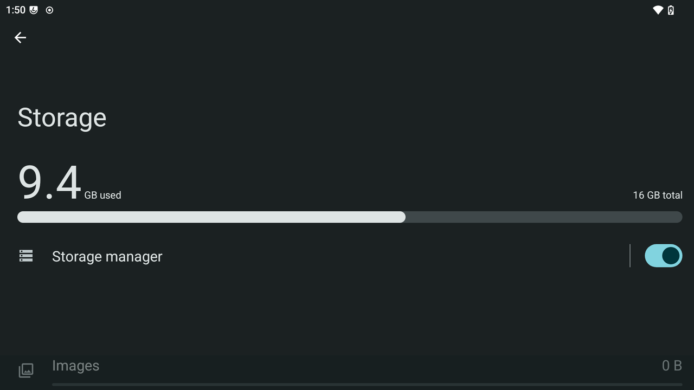

# Software & TV UI

> **Current state:** The Pod cold-boots straight into **Android 15 (LineageOS 22.2)** and **Projectivy Launcher** with 4K@60 Hz HDMI out, automatic hot-plug / TV input-switch reconnect, 5 GHz Wi-Fi, Bluetooth A2DP, 3.5 mm stereo audio, native HDMI-CEC TV remote control, and `msm_watchdog_v2` enabled. The only remaining hardware item is `TC358840` HDMI input, plus optional custom themes and streaming apps.

## Live screen captures & device details

| Home screen, ready to use | Scrolling the app row |
| :---: | :---: |
|  |  |

| Android 15 & LineageOS 22.2 version | Custom kernel (`4.4.302-podmin+`) & build info |
| :---: | :---: |
|  |  |

| Internal storage (16 GB eMMC) |
| :---: |
|  |

We switched to **Projectivy Launcher** (ad-free, with a large Android TV theming and wallpaper community), hid the phone status bar (`policy_control immersive.status=*`), and disabled the 12 leftover stock phone apps (`Dialer`, `Contacts`, `Messaging`, `Calculator`, `Clock`, `Camera`, `Calendar`, `Recorder`, `Gallery`, `Music`, and old Mersive apps) so the home screen stays clean.

### Device details at a glance

| Spec | Running on the Pod |
| --- | --- |
| **Processor** | Qualcomm Snapdragon 820 (`APQ8096`), quad-core Kryo (`arm64-v8a`) |
| **GPU & Video** | Adreno 530 + Qualcomm Venus 4K hardware video decode |
| **Memory** | 4 GB LPDDR4 RAM |
| **Storage** | 16 GB internal eMMC (~9.4 GB used with Android 15 + starter TV apps) |
| **OS** | Android 15 (LineageOS `22.2-20261121-NIGHTLY-h850`) |
| **Kernel** | `4.4.302-podmin+` (with `msm_watchdog_v2` and HDMI-CEC enabled) |

## What is running under the hood

- **System base (`h850` donor):** Official LineageOS 22.2 for the **LG G5 (`h850`)**, which shares the Qualcomm `MSM8996 / APQ8096` platform (Adreno 530 GPU + Venus 4K hardware video decoder). Phone-only HALs (telephony, fingerprint, sensors, NFC, camera) are stripped out.
- **Wireless HALs (`gemini` donor):** Official LineageOS 22.2 QTI Wi-Fi and Bluetooth HALs pulled from the **Xiaomi Mi 5 (`gemini`)** so the Pod's `QCA6174A / Rome` radio speaks native Android 15 alongside our upstream `ath10k_pci` driver.
- **TV launcher & apps:** **Projectivy Launcher** runs as the default home screen, with full support for custom 4K wallpapers, icon packs, and channel rows. Optional upstream apps like `SmartTube`, `F-Droid`, and `FLauncher` install cleanly from their official releases (no APKs are bundled in this repo).
- **Remote & input (HDMI-CEC + Flirc):** Patch `0021-mdss-hdmi-tx-enable-cec.patch` brings Qualcomm's `fb1/cec` controller online on `HDMI 1`, and `system/cec/pod-cec-daemon.c` runs on logical address `8` (`Playback Device 2`), replying to `<Set Stream Path>` (`0x86`) only for our HDMI port so your TV remote works without stealing inputs from game consoles. A **Flirc USB Gen2** or any USB keyboard/mouse also works out of the box on the rear USB 3.0 ports.

## What is working today

1. **Fast cold self-boot into Android 15 (~26 s):** Everything lives on internal eMMC (`boot`, `recovery`, `system`) with `msm_watchdog_v2` enabled.
2. **Automatic 4K@60 Hz HDMI hot-plug & TV input-switch reconnect:** `TLMM GPIO 127` wakes up native `HDMI 1` at `3840x2160@60` / `4096x2160@60` (`594 MHz` pixel clock), and our supervised `pod-hdmi-hotplug.sh` service automatically re-enables the external display whenever you switch TV inputs or hot-plug the cable.
3. **Automatic Wi-Fi, Bluetooth A2DP, and 3.5 mm stereo audio:** `init.pod.wifi.rc` loads `ath10k_pci` after `sys.boot_completed=1`, and `J6 AUDIO` delivers verified left + right stereo audio over `SLIMBUS_6_RX`.
4. **Clean TV defaults baked into `installer/flash-new-pod.ps1`:** Skips the phone setup wizard, disables lockscreen and sleep timer, hides the phone status bar (`policy_control immersive.status=*`), disables 12 leftover phone apps, and sets Projectivy Launcher as default home.

## App compatibility (streaming & game streaming)

Because the Pod runs an unlocked custom Android 15 ROM without Google Android TV certification or Play Services (Widevine L3 software DRM instead of L1), open-source media and game-streaming apps run at full 4K@60 Hz hardware decode, while commercial DRM streamers have limits. No third-party APKs are bundled in this repo; users install official upstream releases or use **Aptoide TV** / **F-Droid** directly on the Pod.

| Category / App | Status | Notes |
| --- | --- | --- |
| **YouTube (SmartTube)** | Works great | Full 4K@60 Hz with Venus hardware decode, ad-free, remote-friendly |
| **Xbox Remote Play / Cloud (Better xCloud)** | Works great | Open-source Android TV app for streaming from a local Xbox or Xbox Cloud Gaming |
| **PC Game Streaming (Steam Link)** | Works great | Low-latency streaming over Gigabit Ethernet with Bluetooth or USB controllers (install Steam Link via Aptoide TV) |
| **Self-Hosted & Local Media (Plex, Jellyfin, Kodi, VLC)** | Works great | Full 4K hardware video decode; Plex installs from the official Plex download, or use Jellyfin/Kodi from upstream releases |
| **App Stores (F-Droid & Aptoide TV)** | Works great | Aptoide TV installs Android TV apps without needing Google Play Services |
| **Netflix** | Limited (L3) | Official Android TV app blocks uncertified devices; mobile/tablet APK caps at 480p/540p (Widevine L3) |
| **Max (HBO), Prime Video, Hulu, Disney+** | Limited (L3) | Typically need Play Services / microG to sign in, cap at 720p/1080p on Widevine L3, and some enforce Play Integrity checks |
| **Apple TV** | Blocked (DRM) | Requires certified Widevine L1 and Google Play Services; refuses DRM playback on unlocked custom ROMs |

## What is left on the list

- **Custom themes & streaming apps:** Projectivy is up and clean, ready for whatever custom 4K wallpapers, icon packs, and streaming apps you want to add.
- **HDMI Input (`TC358840`):** Device-tree nodes are drafted; next step is trimming kernel headroom under `0x2000000` and bringing up the V4L2 capture driver (see [docs/AUDIO-AND-HDMI-IN.md](AUDIO-AND-HDMI-IN.md)).
